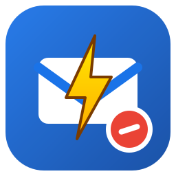

# Gmail AdBlock Ultra — fast, stable ad blocking for Gmail

[](https://github.com/9M2PJU/gmail-adblock-ultra/releases)
[](LICENSE)
[](https://github.com/9M2PJU/gmail-adblock-ultra/releases)
[](https://github.com/9M2PJU/gmail-adblock-ultra/releases)
[](https://github.com/sponsors/9M2PJU)

An ultra-fast, stable browser extension that removes Gmail's **Sponsored** ads, blocks tracking pixels at the network level, and tidies the inbox with enhancements. No page slowdown, no broken emails, no data collection.



## ✨ Features

**Ad blocking**
- Hides **Sponsored rows** in Promotions / Social tabs (badge detection across 20+ locales: *Sponsored, Ad, Annonce, Gesponsert, Patrocinado…*)
- Hides the **Top-picks / Sponsored carousel** above the list
- Hides **side-rail ad links** (`googleadservices` / `doubleclick`)
- Blocks **1px tracking pixels** in-page **and** at the network level (`googleadservices.com`, `doubleclick.net`, `googlesyndication.com`, `google-analytics.com/collect`, Gmail-scoped)

**Enhancements** (popup switches, apply instantly — no reload)
- Hide Chat & Meet sidebar
- Compact inbox density
- Hide Gemini upsell
- Hide Google One / storage upsell

**Why it's fast & stable**
- **CSS-first**: blocking CSS injects at `document_start`, before first paint — ads never flash.
- **Realtime toggles**: the popup pushes changes straight to open Gmail tabs (applies within a frame); `chrome.storage.sync` persists them and covers other tabs as fallback.
- **Batched `MutationObserver`** (`requestAnimationFrame`, 400 nodes/frame, `WeakSet` dedupe) — sub-millisecond overhead, no layout thrash.
- **Never deletes nodes** — only `display:none` on positively-identified ads. Master switch off restores Gmail instantly.

## 📦 Install

### Option A — release zips (recommended)
1. Download the latest release: [releases page](https://github.com/9M2PJU/gmail-adblock-ultra/releases)
   - Chrome/Edge/Brave: `gmail-adblock-ultra-chrome-vX.Y.Z.zip`
   - Firefox: `gmail-adblock-ultra-firefox-vX.Y.Z.zip`
2. **Chrome:** unzip → `chrome://extensions/` → enable **Developer mode** → **Load unpacked** → select the folder.
3. **Firefox:** `about:debugging#/runtime/this-firefox` → **Load Temporary Add-on** → pick `manifest.json` inside the unzipped folder. (For a permanent install, the signed build will be published on [AMO](https://addons.mozilla.org/) — temporary add-ons unload on restart.)
4. Open `https://mail.google.com/` → click the toolbar icon to configure.

### Option B — from source
```bash
git clone https://github.com/9M2PJU/gmail-adblock-ultra.git
cd gmail-adblock-ultra
./build.sh            # produces dist/*.zip for both browsers
```

## 🔒 Privacy & permissions

- All processing is **100% local**. No analytics, no remote code, no data leaves your browser.
- Chrome (MV3): `storage` + `declarativeNetRequest`, host access to `mail.google.com` only.
- Firefox (MV2): `storage` + `webRequest`/`webRequestBlocking`, host access to `mail.google.com` only (request origins are checked — only Gmail-initiated ad/tracker requests are cancelled).

## 🛠 Project structure

```
manifest.json            Chrome MV3 manifest
manifest.firefox.json    Firefox MV2 manifest
src/
  content.js             blocking engine (runs at document_start)
  content.css            CSS-first hiding rules
  popup.html/.css/.js    switches, counter, donate button
  background.js          Chrome MV3 service worker (defaults + DNR toggle sync)
  background.firefox.js  Firefox MV2 background (defaults + webRequest blocking)
rules/dnr.json           Chrome network block rules (Gmail-scoped)
icons/                   official logo (SVG + 16/32/48/128 PNG)
build.sh                 builds dist/ packages + release zips
```

## 🤝 Contributing

Issues and PRs are welcome. Please keep changes small, avoid touching email content nodes, and run `./build.sh` to validate both manifests before submitting.

## ❤ Support

Free forever. If it cleans up your inbox, consider supporting development:

[](https://paypal.me/9M2PJU)
[](https://buymeacoffee.com/9m2pju)
[](https://wise.com/pay/me/faizulz13)
[](https://github.com/sponsors/9M2PJU)

## 📄 License

[MIT](LICENSE) © 2026 9M2PJU
